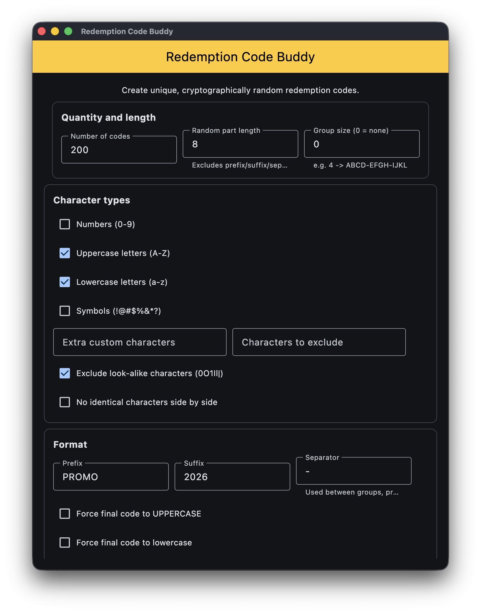
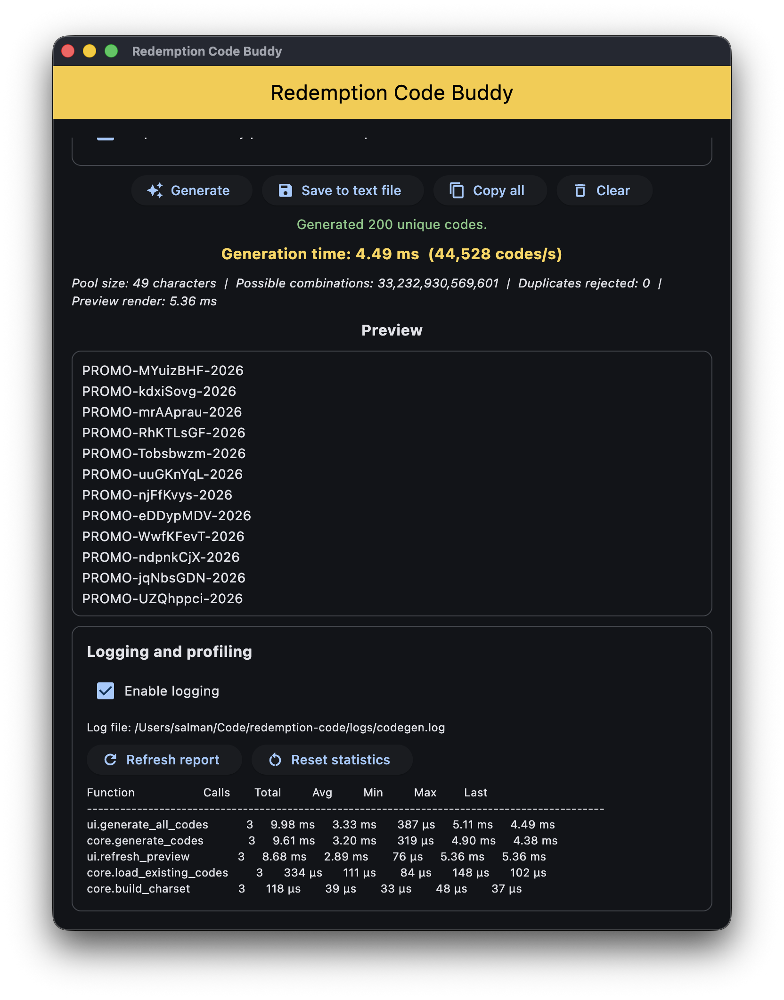

# Redemption Code Buddy

Generate unique, cryptographically random redemption codes in seconds, with full control over length, character types, grouping, prefixes and suffixes. Built with [Flet](https://flet.dev) (Python) as a weekend project.

**Live demo:** https://salmanzaheer.github.io/Redemption-Code-Buddy/





## Features

- **Cryptographically secure**: codes are drawn with Python's [`secrets`](https://docs.python.org/3/library/secrets.html) module, not `random`.
- **Guaranteed unique**: duplicates are rejected, and you get a clear error if your settings can't produce enough unique codes.
- **Flexible character pool**: digits, uppercase, lowercase, symbols, your own extra characters, and a list of characters to exclude.
- **Look-alike protection**: optionally removes easily confused characters (`0 O 1 I l |`).
- **Custom format**: group size (e.g. `ABCD-EFGH-IJKL`), prefix, suffix and separator, plus force-uppercase / force-lowercase.
- **No repeated neighbours**: optionally prevent identical characters side by side.
- **File output**: save to a text file, add a timestamp, append instead of overwrite, and skip codes that already exist in the file.
- **Built-in profiling**: see how long generation took, codes per second, and a per-function timing report.
- **Optional logging** to a rotating log file, toggled from the UI.

## Quick start

Requires Python 3.12 or newer.

### With uv (recommended)

[uv](https://docs.astral.sh/uv/) installs the exact dependency versions from `uv.lock`.

```bash
git clone https://github.com/salmanzaheer/Redemption-Code-Buddy.git
cd Redemption-Code-Buddy
uv run python main.py
```

To run it in your browser instead of a desktop window:

```bash
uv run flet run --web main.py
```

### With pip

```bash
git clone https://github.com/salmanzaheer/Redemption-Code-Buddy.git
cd Redemption-Code-Buddy
python -m venv venv
source venv/bin/activate        # Windows: venv\Scripts\activate
pip install "flet[all]>=1.0.5,<2"   # [all] adds the CLI used for building
python main.py
```

## Using the app

| Section | Option | What it does |
| --- | --- | --- |
| Quantity and length | Number of codes | How many unique codes to generate |
| | Random part length | Characters in the random part (excludes prefix, suffix and separators) |
| | Group size | Splits the random part into groups, e.g. `4` gives `ABCD-EFGH-IJKL`. `0` disables grouping |
| Character types | Numbers / Uppercase / Lowercase / Symbols | Which built-in character sets feed the pool |
| | Extra custom characters | Added to the pool |
| | Characters to exclude | Removed from the pool |
| | Exclude look-alike characters | Removes `0 O 1 I l \|` |
| | No identical characters side by side | Prevents `AA`, `77`, etc. |
| Format | Prefix / Suffix / Separator | e.g. `PROMO-ABCD-EFGH-2026` |
| | Force UPPERCASE / lowercase | Converts the final code (choose one) |
| Output | File name | Suggested name in the save dialog. Defaults to `codes.txt` (`.txt` is added if you leave off an extension) |
| | Add timestamp | `codes_20261024_153000.txt` |
| | Append to file *(desktop only)* | Adds to the file you pick instead of overwriting it |
| | When appending, skip codes already in the file *(desktop only)* | Drops any generated code that is already in that file |

Buttons: **Generate**, **Save to text file** (opens your system's save dialog), **Copy all**, **Clear**. The preview shows the first 500 codes; everything generated is saved or copied.

After generating you'll see how many characters are in the pool and how many combinations are possible, which helps you judge how hard the codes are to guess.

## Project structure

```
.
├── main.py                       # Flet UI
├── core.py                       # Code generation, file handling (no UI code)
├── profiler.py                   # Timing decorators, stats and logging helpers
├── tests/test_performance.py     # Correctness, logging and performance tests
├── assets/screenshots/           # README images
├── pyproject.toml                # Project metadata and dependencies
├── uv.lock                       # Pinned dependency versions
└── .github/workflows/
    └── build-deploy.yml          # Builds the web app and deploys to GitHub Pages
```

The UI (`main.py`) is intentionally thin: all generation logic lives in `core.py`, so it can be tested and reused without Flet.

## Running the tests

```bash
uv run python -m unittest discover -s tests -v
```

Performance tests use generous time budgets. On a slow machine, scale them with an environment variable:

```bash
CODEGEN_PERF_FACTOR=3 uv run python -m unittest discover -s tests -v
```

## Logging and profiling

- Logs are written to `logs/codegen.log` (rotating, 1 MB, 3 backups) and can be toggled in the app.
- Timing statistics are always collected, even when logging is off. Use **Refresh report** / **Reset statistics** in the "Logging and profiling" section.
- Decorate your own functions with `@timed` or wrap blocks in `with Timer("label"):` from `profiler.py`.

## Deploying to GitHub Pages

The workflow in `.github/workflows/build-deploy.yml` builds the app with `flet build web` and publishes it. Pull requests only run the build; deployment happens on pushes to `main`.

**One-time setup:**

1. Push the repository to GitHub.
2. Go to **Settings → Pages**.
3. Under **Build and deployment → Source**, choose **GitHub Actions**.
4. Push to `main` (or run the workflow manually from the **Actions** tab).

Your site will be available at `https://<your-username>.github.io/<repository-name>/`.

To build locally:

```bash
uv run flet build web --base-url Redemption-Code-Buddy --route-url-strategy hash
# output is in build/web; preview with:
python -m http.server --directory build/web 8000
```

The `--base-url` must match your repository name, and the hash route strategy keeps routing working on GitHub Pages (which has no server-side routing).

### Troubleshooting

**`error: Failed to spawn: flet` / `No such file or directory`**
`uv run` only has access to packages declared in `pyproject.toml`. Make sure `pyproject.toml` and `uv.lock` are committed and that `flet` is listed under `dependencies`.

**`No matching distribution found for watchdog` (or another tooling package) during `flet build web`**
Only runtime packages belong in `[project].dependencies`. `flet build web` installs that list into the in-browser Python runtime, which can't use tooling like `flet-cli`/`watchdog`. Keep `flet` there and put `flet[all]` in `[dependency-groups].dev` (as this repo does).

**`uv sync --locked` fails because the lockfile is out of date**
You changed dependencies in `pyproject.toml` without updating `uv.lock`. Run `uv lock` and commit the result.

**The deploy job is skipped**
By design it only runs on pushes to `main`, not on pull requests or other branches.

**Deploy fails with a Pages or permissions error**
Check that **Settings → Pages → Source** is set to **GitHub Actions**.

**The site loads a blank page**
Make sure the build used `--base-url <repo-name>` and `--route-url-strategy hash`. The first load can also take a few seconds while the in-browser Python runtime starts.

## Notes for the web version

The hosted version runs Python inside your browser. A few things behave differently from the desktop app:

- **Save to text file** opens your browser's normal download flow, so `codes.txt` lands in your Downloads folder.
- **Append** and **skip codes already in the file** are hidden, because a browser can't read or modify files on your computer.
- Nothing you generate is sent to a server. Codes are created entirely on your device.

## A note on security

Codes are generated with `secrets`, which is suitable for hard-to-guess values. Redemption codes are only as safe as your redemption system, though: store them hashed where you can, rate-limit redemption attempts, and make sure your code space is large enough. The pool and combination counts shown after generating help you check that.

## Built with

- [Python](https://www.python.org/)
- [Flet](https://flet.dev)
- [uv](https://docs.astral.sh/uv/)
